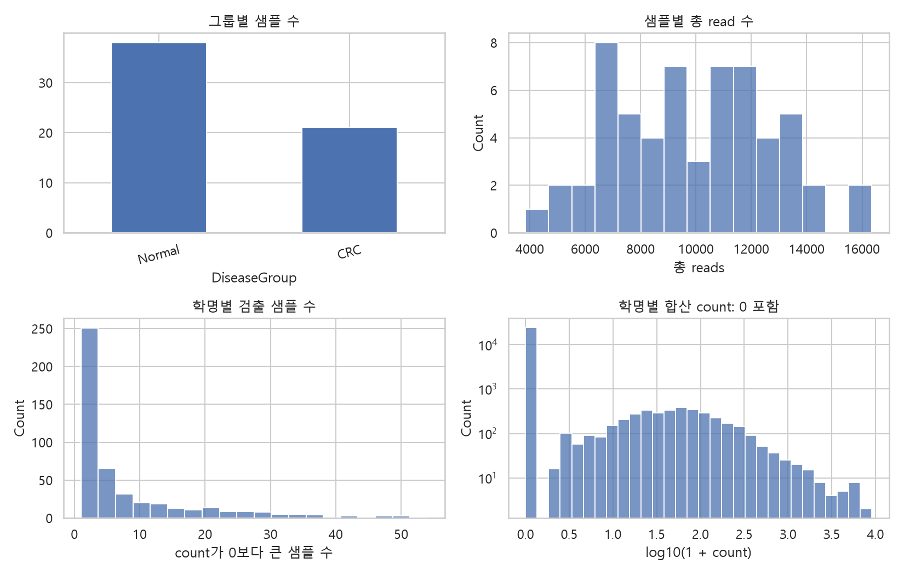
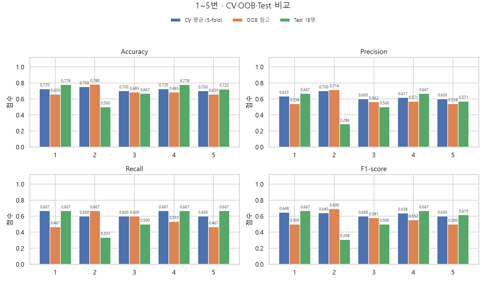

# 장내 마이크로바이옴 기반 CRC 분류

**ASV read count와 BLAST 참조 정보를 연결해 대장암 여부를 분류하고, 예측에 영향을 준 미생물 특성을 보여주는 머신러닝 프로젝트입니다.** 데이터 통합부터 EDA, 특성 선택, 교차검증, 모델 저장, Streamlit 추론 화면까지 구현했습니다.

| 항목 | 내용 |
| --- | --- |
| 개발 기간 | 2026.10.29 ~ 2026.10.31 — BLAST 조회·노트북·최종 보고서 기록 기준 |
| 프로젝트 성격 | 머신러닝 학습 및 서비스 프로토타입 |
| 예측 대상 | `CRC` / `Normal` 2분류 |
| 입력 | 한 샘플의 DNA 서열별 ASV read count |
| 서비스 모델 | Random Forest, 미생물 특성 171개 |
| 데모 | Streamlit CSV 업로드 → 예측 확률 → SHAP 기여도 |

> 이 프로젝트의 `Normal`은 **Healthy와 Adenomatous Polyps를 합친 비대장암 그룹의 코드명**입니다. 용종 환자를 포함하므로 의학적 의미의 정상군으로 해석하지 않습니다. 예측 결과는 학습용 분류 결과이며 실제 진단이나 발병 확률이 아닙니다.

## 프로젝트 배경

원본 데이터는 샘플별 ASV 검출량, 서열별 taxonomy, 환자 메타데이터로 나뉘어 있었습니다. 특히 6,693개 ASV 중 기존 Species 정보가 비어 있는 항목이 6,623개여서, 모델의 입력과 결과를 사람이 읽을 수 있는 정보로 연결하는 과정이 필요했습니다.

NCBI BLAST 결과와 accession–TaxID 대응표를 이용해 ASV를 참조 학명에 연결하고, 같은 참조 학명으로 연결된 ASV read를 합산했습니다. 이후 샘플 간 read depth 차이를 상대풍부도로 보정하고, 여러 특성 선택 방법을 동일한 분할에서 비교했습니다.

## 기술 스택

| 구분 | 사용 기술 |
| --- | --- |
| 언어·분석 환경 | Python 3.12.6, Jupyter Notebook |
| 데이터 처리 | pandas, NumPy, openpyxl |
| 생물정보 연결 | NCBI BLAST 결과, NCBI accession·TaxID 대응표 |
| 모델·검증 | scikit-learn RandomForestClassifier, Pipeline, GridSearchCV, Normalizer |
| 특성 분석 | RF importance, Spearman 상관계수, statsmodels VIF |
| 시각화·설명 | Matplotlib, seaborn, SHAP |
| 서비스·모델 저장 | Streamlit, joblib |

## 데이터와 처리 과정

| 항목 | 실제 확인한 규모 |
| --- | ---: |
| 전체 샘플 | 59개 |
| Healthy / Adenomatous Polyps / CRC | 19 / 19 / 21개 |
| 원본 ASV | 6,693개 |
| BLAST hit가 있는 ASV | 5,846개 |
| 통합 BLAST hit | 586,156행 |
| 참조 accession | 8,026개 |
| 합산 후 참조 학명 특성 | 477개 |
| Train / Test | 41 / 18개 |

원본 설명서의 60개와 달리 실제 파일에는 59개 샘플이 있습니다. 분석과 성능 기록에는 실제 파일의 수를 사용했습니다.

1. **파일별 키 검증**: count 표의 샘플명과 metadata의 `host_disease`, count의 DNA 서열과 taxonomy 서열을 연결합니다. ASV ID는 원본 taxonomy 행 순서를 기준으로 복원합니다.
2. **BLAST 연결**: accession과 TaxID의 미매칭·불일치를 확인한 뒤 ASV별 최고 bit score 행을 선택합니다. 현재 구현은 동률일 때 첫 행을 사용합니다.
3. **학명별 read 합산**: BLAST 참조 학명이 같은 ASV의 read를 합산해 477개 특성을 구성합니다. 이는 참조 서열 기반 집계이며 실제 생물종 확정 결과는 아닙니다.
4. **전체 read 합 보존**: BLAST에 연결되지 않은 847개 ASV의 read도 `unmatched_reads`로 남겨 상대풍부도 분모에 포함합니다. 이 열 자체는 모델 특성에서 제외합니다.
5. **데이터 분리**: 원본 3개 질병 그룹을 기준으로 층화해 Train/Test를 7:3으로 고정합니다(`random_state=42`). 예측 타깃은 비대장암 38명 / CRC 21명입니다.
6. **학습과 특성 선택**: L1 정규화 → fold 안에서 특성 선택 → 클래스 가중치를 적용한 Random Forest 순서로 학습합니다.
7. **평가·서비스**: CV·OOB·Test를 구분해 기록하고, 실험 1번 모델을 Streamlit에서 사용합니다.



## 비교 실험과 결과

Random Forest는 300개 트리와 `class_weight="balanced"`를 사용합니다. `max_depth`, `min_samples_leaf`, `max_features`를 탐색하고, 실험 1번은 3·5·7-fold와 중요도 사분위 선택 규칙도 비교했습니다. 선택된 5-fold 설정을 다른 실험에 공통 적용했습니다.

아래 Precision·Recall·F1은 **CRC를 양성으로 계산한 값**이며 Macro F1이 아닙니다. 특성 수는 전체 Train으로 다시 학습한 모델 기준입니다.

| 실험 | 변경 내용 | 특성 수 | CV F1 평균 | OOB F1 참고 | Test Accuracy | Test CRC F1 |
| --- | --- | ---: | ---: | ---: | ---: | ---: |
| 1 — 서비스 적용 | RF 양수 중요도 사분위 선택 | 171 | 0.648 | 0.500 | 0.778 | 0.667 |
| 2 | VIF 5 미만 특성 선택 | 22 | 0.640 | 0.690 | 0.500 | 0.308 |
| 3 | 상수·Spearman 상관 중복 제거 | 306 | 0.600 | 0.581 | 0.667 | 0.500 |
| 4 | 상관 중복 제거 후 중요도 선택 | 152 | 0.638 | 0.552 | 0.778 | 0.667 |
| 5 | 실험 1의 미생물 특성 + 나이·성별 | 173 | 0.600 | 0.500 | 0.722 | 0.615 |

실험 1번은 Test 18개 중 14개를 맞혔으며, CRC 6개 중 4개를 검출했습니다(Precision·Recall 각각 0.667). CV F1 표준편차는 약 0.214로, 샘플이 적어 분할에 따른 변동이 큽니다.

VIF를 적용해 특성을 크게 줄였을 때 OOB 결과는 높았지만 Test CRC F1은 0.308로 낮아졌습니다. 나이·성별 추가도 이번 분할에서는 개선으로 이어지지 않았습니다. 전처리의 복잡도나 특정 검증 점수 하나만으로 일반화 성능을 판단하기 어렵다는 점을 확인했습니다.



**평가 범위:** CV는 같은 Train 안에서 설정을 탐색한 내부 검증 점수입니다. OOB는 전체 Train에서 특성을 선택한 뒤 계산한 참고 지표입니다. Test 역시 여러 모델을 비교하고 재평가한 기록이 있으며, 이후 실험 1번을 서비스 모델로 지정했습니다. 따라서 위 수치를 한 번만 사용한 최종 독립 검증이나 임상 성능으로 제시하지 않습니다.

결과 원본: [실험 비교](outputs/simple_oob/experiment_results.csv) · [Test 지표](outputs/simple_oob/test_metrics.csv) · [실행 설정](outputs/simple_oob/run_manifest.json)

## 구현한 서비스

- `sequence,read_count` 형식의 CSV를 업로드하면 DNA 서열을 저장된 참조 학명 대응표에 연결합니다.
- 같은 학명으로 연결되는 ASV read를 합산하고 학습 때와 같은 전체 read 분모로 정규화합니다.
- 빈 파일, 열 이름 오류, 음수·비정수 count, 총 read 0, 모델 특성에 연결되는 read 부재를 검사합니다.
- CRC / Normal 분류 결과와 각 클래스 확률을 표시합니다.
- 해당 입력에서 예측 클래스에 영향을 준 상위 10개 특성을 SHAP 막대그래프로 설명합니다.
- 모델·scaler·입력 열 순서·서열 대응표를 하나의 bundle로 저장해 학습과 추론의 입력 구성을 맞춥니다.

## 트러블슈팅과 판단

| 문제 | 확인·해결한 방법 | 남은 한계 |
| --- | --- | --- |
| 검출량·taxonomy·metadata의 식별자가 서로 다름 | 샘플 키와 DNA 서열 키를 각각 사용하고, ASV ID를 taxonomy 원본 순서로 복원했습니다. 중복·미매칭·정답 결측을 확인했습니다. | 입력 파일의 행 순서나 키 규칙이 바뀌면 재검증이 필요합니다. |
| 종 정보 결측이 많아 결과 해석이 어려움 | BLAST hit와 accession–TaxID 표를 연결하고 참조 학명별 read 합산 구조를 만들었습니다. | 최고 점수 동률의 첫 행 선택은 모호성을 남깁니다. 참조 학명을 실제 종 판정으로 단정할 수 없습니다. |
| 미매칭 ASV를 버리면 상대풍부도 분모가 달라짐 | 미매칭 read를 정규화 입력에 포함한 뒤 예측 특성에서 제외해 전체 원본 read 합을 유지했습니다. | 서열 대응률이 낮은 새 데이터에서는 분포 차이가 커질 수 있습니다. |
| 전체 Train에서 미리 고른 특성으로 CV를 하면 누수 발생 가능 | 중요도·VIF·상관 필터를 `Pipeline`의 선택기에 넣고 각 학습 fold 안에서 다시 계산했습니다. | 설정 탐색에 사용한 CV의 선택 편향은 별도 외부 검증으로 확인해야 합니다. |
| 상관 중복·다중공선성을 줄이면 항상 좋아지는지 불확실 | VIF, Spearman 중복 제거, 중요도 선택, 나이·성별 추가를 분리해 비교했습니다. | VIF의 OOB 우위가 Test 개선으로 이어지지 않았습니다. |
| 노트북의 사용자 정의 선택기 때문에 서비스에서 모델 로딩이 복잡해질 수 있음 | 배포 bundle에는 학습된 RF와 선택 열·정규화 정보만 저장해 사용자 정의 선택기 없이 추론하도록 구성했습니다. | joblib 로딩에는 학습 당시와 호환되는 패키지 환경이 필요합니다. |

## 실행 방법

### 1. 환경 구성

프로젝트 루트에서 Python 3.12 환경을 새로 만듭니다. 저장 모델은 현재 기록된 scikit-learn 버전과 맞춰 사용하는 편이 안전합니다.

```powershell
python -m venv .venv
.\.venv\Scripts\python.exe -m pip install -r requirements.txt
```

### 2. Streamlit 데모

저장된 `outputs/simple_oob/1_model.joblib`을 사용하면 원본 학습 데이터 없이 데모를 실행할 수 있습니다.

```powershell
.\.venv\Scripts\python.exe -m streamlit run streamlit_microbiome_crc.py
```

입력 형식은 아래와 같습니다. `sequence`에는 모델의 서열 대응표에 포함된 실제 DNA 서열을 넣습니다.

```csv
sequence,read_count
ACTUAL_ASV_DNA_SEQUENCE,120
```

CSV에 없는 서열은 0으로 취급합니다. 새로 들어온 미매칭 서열의 read는 정규화 분모에 포함됩니다.

### 3. 분석 노트북

```powershell
.\.venv\Scripts\python.exe -m notebook microbiome_crc.ipynb
```

처음부터 학습하려면 아래 파일을 별도로 준비해야 합니다. 공개 저장소에서는 원본 데이터, 환자별 검출량·메타데이터·예측표, 전체 BLAST 결과와 캐시를 제외했습니다. 노트북의 저장된 출력도 제거했으며, 집계 지표와 그림을 함께 제공합니다.

| 위치 | 필요한 파일 |
| --- | --- |
| `dataset/` | `seqtab_nochim_export.xlsx`, `taxa_species_export.xlsx`, `metadata.csv` |
| `dataset/blast_merged_taxid/` | `blast_hits_merged_taxid.csv`, `accession_taxid_mapping.csv` |

현재 노트북은 쉼표로 구분된 `metadata.csv`를 읽습니다. 원본을 다시 내려받았을 때 구분자가 세미콜론이라면 로딩 셀의 `sep`를 해당 파일에 맞춰야 합니다. 노트북 전체 실행은 GridSearchCV 학습과 기존 결과 파일 재생성을 포함합니다.

## 주요 파일

| 경로 | 내용 |
| --- | --- |
| [`microbiome_crc.ipynb`](microbiome_crc.ipynb) | 파일 통합, EDA, 특성 선택, 학습·평가 |
| [`streamlit_microbiome_crc.py`](streamlit_microbiome_crc.py) | CSV 기반 예측·SHAP 화면 |
| `outputs/simple_oob/1_model.joblib` | 서비스 적용 모델·정규화·서열 대응 bundle |
| `outputs/simple_oob/experiment_results.csv` | CV·OOB 비교 |
| `outputs/simple_oob/test_metrics.csv` | 고정 Test 비교 |
| `outputs/simple_oob/run_manifest.json` | 분할·클래스 정의·탐색·모델 선택 기록 |
| `outputs/simple_oob/figures/` | 데이터 분포·중요도·평가 그림 |

현재 README의 수치와 서비스 모델은 **`outputs/simple_oob/`를 기준**으로 합니다. 공개 모델에서는 학습 샘플 식별자와 추론에 필요하지 않은 샘플별 OOB 정보를 제거했습니다. 원본 모델과 합성 입력의 예측·확률이 동일함을 확인했으며, 재학습은 수행하지 않았습니다.

## 배운 점과 개선 방향

- 데이터 통합에서는 모델 이전에 **행의 단위, 연결 키, read 합 보존**을 확인해야 합니다.
- 특성 선택을 CV 안에서 수행하는 것과, 탐색에 사용한 CV 점수를 최종 성능으로 해석하는 문제는 별도로 다뤄야 합니다.
- 특성 수를 줄이거나 임상 정보를 추가해도 성능이 자동으로 좋아지지 않으므로 같은 조건의 실험으로 확인해야 합니다.
- 향후에는 BLAST 동률 후보 처리, 외부 코호트 검증, 확률 보정, 입력 서열 매칭률에 따른 추론 품질 안내를 보완할 수 있습니다.

## 데이터 출처

원본 `dataset/README.md`가 안내하는 출처는 [ColorectalCancer-Detection](https://github.com/aramelheni/ColorectalCancer-Detection)입니다. 16S rRNA 시퀀싱을 DADA2로 전처리한 ASV 데이터와 메타데이터를 사용했으며, BLAST 참조 정보는 2026.10.29 조회 기록을 바탕으로 연결했습니다. 원본 데이터의 이용·재배포 조건은 원출처를 따릅니다.
